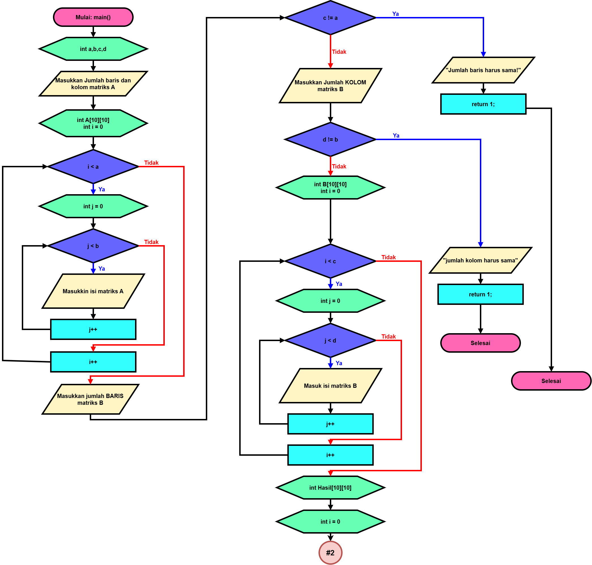

# Flowchart Generator

Mengubah kode C++ menjadi flowchart secara otomatis. Programnya membaca kode lewat parser [tree-sitter](https://tree-sitter.github.io/) dan menghasilkan file `.drawio` yang bisa dibuka dan diedit di [draw.io](https://app.diagrams.net).



## Fitur

- Membaca kode C++ dengan parser sungguhan (tree-sitter), bukan pencocokan teks
- Alur dimulai dari nama fungsi (`Mulai`) dan diakhiri `Selesai`
- Bentuk simpul sesuai standar flowchart: terminator (oval), proses (persegi), input/output (jajar genjang), keputusan (belah ketupat), dan inisialisasi (heksagon)
- Deklarasi variabel beruntun digabung menjadi satu simpul inisialisasi, begitu juga `cin` atau `cout` beruntun
- Mendukung `if` / `if-else`, perulangan `for` dan `while`, `return`, serta `goto` dengan label
- Panah **Ya** berwarna biru dan **Tidak** merah, dengan panah balik perulangan di sisi kiri
- Warna, ukuran, dan jarak mudah diubah lewat tabel gaya di `flow.py`

## Kebutuhan

- Python 3
- Paket di `requirements.txt` (`tree-sitter` dan `tree-sitter-cpp`)

## Cara Pakai

```
git clone https://github.com/rivanfathur-rgb/flowchart-generator.git
cd flowchart-generator
python -m venv .venv
.venv\Scripts\activate
pip install -r requirements.txt
python flow.py examples/input.cpp
```

(Di Linux atau macOS, aktifkan venv dengan `source .venv/bin/activate`.)

Hasilnya disimpan di `hasil.drawio` pada folder tempat kamu menjalankan perintah. Jika tidak diberi nama file, program membaca `input.cpp` di folder yang sama.

Untuk membuka hasilnya: buka [app.diagrams.net](https://app.diagrams.net), pilih **File → Open from → Device**, lalu pilih `hasil.drawio`. Dari sana flowchart bisa diedit atau diekspor ke PNG, SVG, atau PDF.

## Contoh

| Berkas | Keterangan |
|--------|------------|
| `examples/input.cpp` | Program C++ penjumlahan dua matriks |
| `examples/hasil.drawio` | Flowchart hasil dari `input.cpp` |

## Cara Kerja

1. tree-sitter mengurai kode C++ menjadi pohon sintaks.
2. Program menelusuri pohon dan membuat daftar simpul (kotak flowchart) dan panah.
3. Posisi simpul dihitung: baris menurut urutan alur, kolom untuk cabang ke samping.
4. Semuanya ditulis sebagai file `.drawio`.

## Mengubah Gaya

Edit tabel di bagian "TABEL GAYA" pada `flow.py`: `BENTUK`, `UKURAN`, `WARNA_BENTUK`, `WARNA_PANAH`, `JARAK`, dan `LEBAR_KOLOM`.

## Keterbatasan

- `do-while`, `switch`, `break`, dan `continue` belum ditangani khusus, jadi ditampilkan sebagai kotak proses biasa
- Nama file hasil selalu `hasil.drawio`

## Struktur Proyek

```
.
├── flow.py
├── requirements.txt
├── examples/
│   ├── input.cpp
│   └── hasil.drawio
├── docs/
│   └── contoh-hasil.png
└── LICENSE
```

## Lisensi

Dirilis di bawah lisensi MIT. Lihat berkas [LICENSE](LICENSE).
